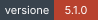
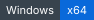
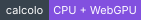
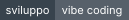
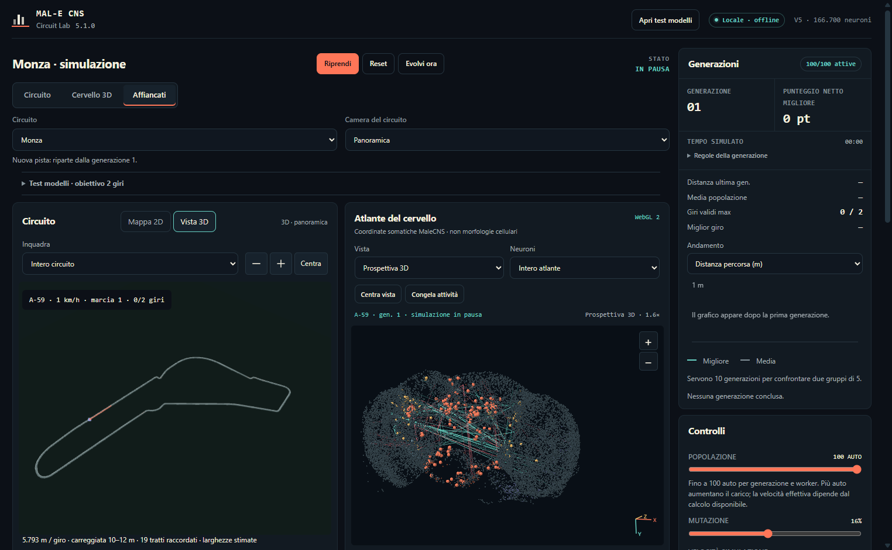
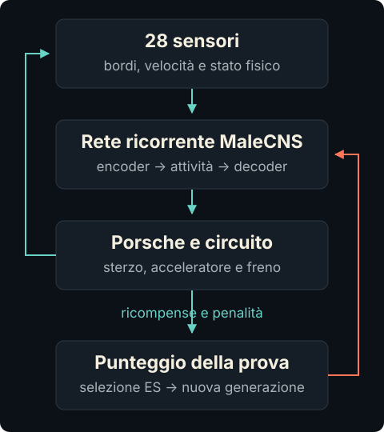
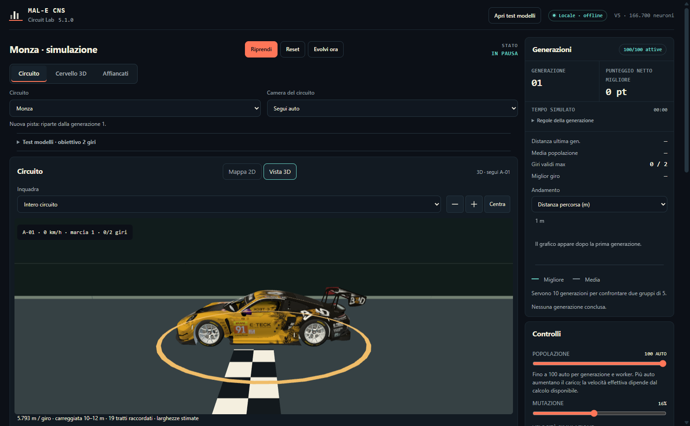
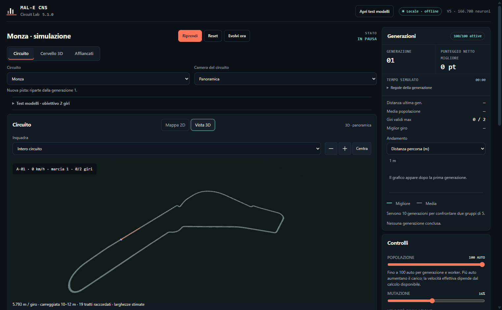

<div align="center">

# MAL-E CNS Circuit Lab

### Un laboratorio locale per far imparare a guidare una rete basata sul connectome della mosca.

**Osserva il cervello. Segui le auto. Confronta l'apprendimento.**

[](https://github.com/Riccardozono/male-cns-circuit-lab/releases/tag/v5.5.0)
[](#avvio-rapido)
[](#faq)
[](#faq)
[](#sviluppo-con-openai-codex)

**[Scarica la portable](https://github.com/Riccardozono/male-cns-circuit-lab/releases/download/v5.5.0/MAL-E-CNS-Circuit-Lab-portable-5.5.0-x64.exe) · [Scarica l'installer](https://github.com/Riccardozono/male-cns-circuit-lab/releases/download/v5.5.0/MAL-E-CNS-Circuit-Lab-setup-5.5.0-x64.exe) · [Note della release](https://github.com/Riccardozono/male-cns-circuit-lab/releases/tag/v5.5.0)**

[Avvio rapido](#avvio-rapido) · [Come funziona](#come-funziona) · [Anteprime](#anteprime) · [Modelli](#modelli-neurali) · [FAQ](#faq) · [Documentazione](#documentazione)

<br />



<br />

*L'app 5.1.0 in vista affiancata: circuito, atlante del cervello e telemetria. Anteprima in pausa, non un risultato di apprendimento.*

</div>

---

MAL-E CNS Circuit Lab è un'app sperimentale per Windows: una popolazione di Porsche 992 GT3 R riceve sensori fisici, produce comandi di guida e viene valutata su un circuito. Puoi osservare ogni auto, esplorare il cervello in 3D e confrontare i profili **V2, V3, V4 e V5**.

La struttura anatomica fa riferimento a **[natverse/malecns](https://github.com/natverse/malecns)** e agli export ufficiali **[MaleCNS](https://male-cns.janelia.org/download/)**. Dinamica neurale, sensori, decoder motorio e apprendimento sono implementazioni artificiali del laboratorio: **non è una simulazione biologica validata del cervello di una mosca**.

La simulazione usa risorse locali, senza inviare le decisioni di guida a un servizio AI cloud. Il progetto è stato sviluppato in **vibe coding con OpenAI Codex**; i modelli OpenAI utilizzati nello sviluppo sono elencati [qui](#sviluppo-con-openai-codex).

**Novità 5.5.0:** tribune 3D con sedute, gradoni, scale, parapetti e coperture, più box, cabine di pista, portale di partenza e cartelli di frenata illustrativi. Trovale in **Vista 3D → Inquadra → Tribune e box**. Le zone delle tribune fanno riferimento alle mappe ufficiali 2026; architettura, misure e raccordo con il tracciato sono stime dichiarate. Le sedute vicine usano dettaglio adattivo; tutta la nuova geometria richiede al massimo tre batch di disegno. Fisica e apprendimento della 5.4.0 restano invariati. [Guida e fonti](outputs/TRIBUNE-v550.md) · [Verifiche](outputs/VERIFICA-v550.md).

Restano gli asset della 5.4.0: i due alberi dello ZIP dell'utente, con la loro texture originale, gli edifici di Monaco e le case di Le Mans scaricate da Sketchfab con licenza **CC BY 4.0**. Case, alberi e cespugli rimangono fuori dalla carreggiata e dalle vie di fuga e lasciano spazio alle nuove strutture; **Dettagli: sì/no** nasconde tutta la scenografia. Posizioni e scale sono illustrative, non un rilievo delle case reali. [Guida agli asset](outputs/ASSET-AMBIENTE-v540.md) · [Crediti e adattamenti](outputs/assets/ENVIRONMENT-CREDITS.md).

Restano attivi i dislivelli della 5.3.0: gravità, accelerazione, frenata e carico degli pneumatici dipendono dalla superficie condivisa. Quote locali e raccordi sono **stime esplicite**, non un rilievo altimetrico completo. Nascondere la scenografia non disattiva la fisica del terreno. [Fonti e limiti del terreno](outputs/TERRENO-v530.md).

La scenografia introdotta nella 5.2.0 rimane: sei vie di fuga a Monza, tre a Monaco e nove a Le Mans, senza accessi di servizio. Barriere e verde non aggiungono collisioni; geometria XY, policy neurale, algoritmi di apprendimento e ricompense sono conservati. Il nuovo ambiente fisico può invece cambiare il comportamento delle auto. [Scenografia 5.2.0](outputs/AMBIENTE-3D-v520.md).

## Avvio rapido

### Scarica e apri l'app

- **[Portable Windows x64](https://github.com/Riccardozono/male-cns-circuit-lab/releases/download/v5.5.0/MAL-E-CNS-Circuit-Lab-portable-5.5.0-x64.exe)** — avvio senza installazione; non richiede Node.js.
- **[Installer Windows x64](https://github.com/Riccardozono/male-cns-circuit-lab/releases/download/v5.5.0/MAL-E-CNS-Circuit-Lab-setup-5.5.0-x64.exe)** — installazione con collegamenti nel menu Start e sul desktop.

La [release 5.5.0](https://github.com/Riccardozono/male-cns-circuit-lab/releases/tag/v5.5.0) contiene note e checksum. Gli eseguibili non sono firmati Authenticode: Windows SmartScreen potrebbe mostrare un avviso al primo avvio.

### Esplora una prova

1. Scegli **circuito**, **modello** e **popolazione**. Usa **Pausa / Riprendi** per controllare la simulazione.
2. Alterna **Mappa 2D** e **Vista 3D**. In **Camera del circuito**, scegli **Segui auto** o **Panoramica**.
3. Apri **Cervello 3D** oppure **Affiancati** per leggere il circuito e l'atlante insieme.
4. Guarda distanza, giri validi e tempo sul giro oltre ai punti: un punteggio più alto, da solo, non dimostra che l'auto stia guidando meglio.
5. Salva i progressi prima di chiudere. I file `.malecns-save` sono condivisibili, ma richiedono **la stessa versione dell'app**.

### Confronta i modelli da zero

Premi **Apri test modelli**, poi **Avvia V2 · V3 · V4 · V5**. Ogni modello parte da zero sul circuito scelto, con le stesse impostazioni e un worker. Il test mette in pausa l'addestramento normale e ne conserva i progressi.

L'obiettivo è che **la stessa auto completi due giri**, seguiti dalla fine naturale della generazione. Una generazione terminata soltanto per urti o stallo non conta come successo. Il pannello distingue tempo reale, tempo simulato e tempo dei due giri; puoi esportare i risultati in JSON.

## Come funziona

L'auto non segue un percorso preregistrato: la policy riceve osservazioni sensoriali e cerca un comportamento attraverso la valutazione delle prove. Non usa un pilota guida, una traiettoria ideale o un insegnante nascosto.

<p align="center">
  
</p>

La fisica produce nuove osservazioni; la rete le elabora e il decoder produce sterzo e azione longitudinale. Ricompense e penalità valutano progresso, checkpoint, giri validi, ritmo, stallo, uscite, urti, retromarcia e regressione. Un'auto termina dopo due giri oppure quando l'episodio fallisce.

La strategia evolutiva apprende i parametri dell'encoder, del decoder e dei gruppi di guadagno della policy. **Non addestra individualmente milioni di connessioni anatomiche.** La ricorrenza dei profili completi può usare WebGPU; fisica, sensori, ricompense e selezione restano sui worker CPU.

Fonti dell'implementazione: [policy e ottimizzatore](outputs/neural-learning.js), [simulazione](outputs/simulation.js), [profili neurali](outputs/model-profiles.js).

## Cosa puoi osservare

| Nell'app | Cosa trovi |
| --- | --- |
| **Circuito** | Mappa 2D interattiva, zoom, pan, raggi dei sensori e selezione delle auto. |
| **Circuito 3D** | Panoramica, inseguimento, vegetazione e rilievo stimato condiviso con la fisica. |
| **Atlante MaleCNS** | Coordinate somatiche, selezione e ricerca dei neuroni, attività della rete e uscite motorie. |
| **Porsche 992 GT3 R** | Modello 3D con texture locali, livrea, ruote animate e luci di frenata. |
| **Fisica e telemetria** | Inerzia, forze G, pendenza e carico normale, pneumatici, aerodinamica, carburante, temperature, ABS, controllo di trazione e cambio sequenziale a sei rapporti. |
| **Apprendimento** | Fino a 100 agenti per generazione e worker, mutazioni, ricompense, penalità e confronto fra modelli. |
| **Progressi** | Distanza e tempi separati dai punti, storico delle generazioni e salvataggi condivisibili. |

Le auto **non collidono tra loro**. La carreggiata usata da disegno, sensori e controllo delle uscite è la stessa: la visualizzazione non aggiunge una seconda geometria di guida.

## Anteprime

### Porsche 992 GT3 R in 3D



Il modello fornito nello ZIP dall'utente usa texture locali e livelli di dettaglio per contenere il costo del rendering. La telecamera cambia l'osservazione, non le decisioni dell'IA. [Crediti del modello](outputs/assets/PORSCHE-3D-CREDITS.md) · [Verifica delle texture](outputs/TEXTURE-v510.md).

### Circuiti in scala metrica



Queste anteprime sono della **5.1.0** e non mostrano il verde e il terreno introdotti nella 5.3.0. Le viste mostrano la geometria del simulatore, con larghezze locali stimate e cordoli documentati. Sono approssimazioni delle mappe, **non rilievi laser o CAD ufficiali**.

| Circuito | Lunghezza planimetrica nel simulatore |
| --- | ---: |
| **Monza** | 5.793 m |
| **Monaco** | 3.337 m |
| **Le Mans** | 13.626 m |
| **Laboratorio** | Tracciato di prova locale |

Le lunghezze XY sono conservate. La distanza lungo la superficie inclinata è leggermente maggiore; il profilo modellato ha un intervallo di quota di 8 m a Monza, 42 m a Monaco e 34 m a Le Mans. **Questi intervalli non sono misure certificate dei circuiti reali.** Il Laboratorio resta piano. [Terreno e fisica 5.3.0](outputs/TERRENO-v530.md).

[Geometrie e fonti](outputs/CIRCUITI.md) · [Renderer 3D e limiti](outputs/VISTA-3D-v510.md) · [Origine delle anteprime](docs/assets/README.md).

## Modelli neurali

I profili V2–V5 sono eseguiti **dall'app**, non da OpenAI. Il confronto cambia il costo e la capacità del controller, non la pista o le regole fisiche.

| Profilo | Neuroni anatomici | Archi | Caratteristica |
| --- | ---: | ---: | --- |
| **V2** | 1.121 | 32.351 | Nucleo compatto ricostruito, per prove rapide. |
| **V3** | 7.721 | 242.486 | Sottoinsieme storico intermedio del connectome. |
| **V4** | 166.700 | 6.242.118 | Dataset completo incluso; solver sparso da 8.192 slot, 2 passaggi e 64 letture motorie. |
| **V5** | 166.700 | 6.242.118 | Stessa anatomia; 32.768 slot, 4 passaggi e 128 letture motorie. |

V4 e V5 condividono il dataset annotato e gli archi con **almeno cinque sinapsi**. V5 amplia il budget del solver e il decoder: **non aggiunge neuroni biologici inventati**. Gli slot sono una capacità massima, non il numero di neuroni necessariamente attivi a ogni aggiornamento.

Più capacità significa anche più calcolo; non garantisce un apprendimento più veloce. Le prove brevi o un singolo seed non dimostrano convergenza su tutti i circuiti. [Dettaglio V5](outputs/MODELLO-V5.md) · [Metadati anatomici](outputs/data/connectome-full.json).

## Origine del cervello

Il riferimento upstream è **[natverse/malecns](https://github.com/natverse/malecns)**, il progetto R per lavorare con i dati MaleCNS. È collegato nel repository tramite il [submodule `work/malecns`](work/malecns).

L'app non esegue direttamente il pacchetto R durante una prova: carica [export offline e manifest](outputs/data/) derivati dai dati ufficiali MaleCNS. Fonti, conteggi, licenze e checksum sono conservati nella [provenienza dei dati](outputs/data/provenance.json).

La struttura anatomica è distinta dalla dinamica artificiale a tassi normalizzati. Potenziali di membrana, ritardi sinaptici e una fisiologia completa della mosca non vengono simulati. Il progetto è un esperimento di controllo e apprendimento, non una validazione neuroscientifica.

## Sviluppo con OpenAI Codex

Questo è un progetto realizzato in modalità **vibe coding**: richieste in linguaggio naturale, iterazioni assistite da OpenAI Codex e verifiche sul codice e sull'app.

I modelli OpenAI utilizzati dall'autore sono:

| Modello OpenAI | Ambiente |
| --- | --- |
| **GPT-6 Astra** | OpenAI Codex |
| **GPT-6 Luna** | OpenAI Codex |
| **GPT-6.1 Sol** | OpenAI Codex |
| **GPT-5.6 Luna** | OpenAI Codex |

L'elenco è quello indicato dall'autore. Per la cronologia precedente non esiste un registro completo che attribuisca ogni commit a uno specifico modello. **Questi modelli hanno assistito lo sviluppo; non guidano le auto durante la simulazione.**

Dall'11 ottobre 2026, i nuovi commit assistiti da IA indicano il modello usato. Ogni nuova versione dell'app riporta i modelli di sviluppo anche nelle note della release, insieme a portable, installer Windows e checksum. [Regole di pubblicazione e attribuzione](docs/RELEASING.md).

## FAQ

<details>
<summary><strong>Serve Node.js per usare l'app Windows?</strong></summary>

No per portable e installer: contengono il runtime. Node.js e npm servono se vuoi avviare il progetto da sorgente o generarne una build.

</details>

<details>
<summary><strong>L'app usa la GPU? Posso ottenere sempre 30×?</strong></summary>

La ricorrenza neurale dei profili completi usa WebGPU quando disponibile, con fallback CPU. Fisica, sensori e ottimizzazione restano sulla CPU; il rendering 3D è un percorso separato. Non è un backend CUDA.

Lo slider arriva a **30× richiesto**. Il rapporto effettivo fra tempo simulato e tempo reale dipende da modello, numero di auto e hardware: 100 agenti con V5 non garantiscono 30× reali.

</details>

<details>
<summary><strong>Gli agenti imparano sempre a completare un giro?</strong></summary>

Non è garantito. La policy parte senza un pilota preaddestrato e può produrre stallo, urti o peggioramenti. I risultati dipendono da seed, circuito, profilo, popolazione e generazioni.

Per valutare un miglioramento, confronta distanza, giri validi e tempi, non soltanto i punti. La modalità test confronta i quattro modelli da zero e registra anche i tentativi falliti.

</details>

<details>
<summary><strong>V5 aggiorna tutti i 166.700 neuroni a ogni tick?</strong></summary>

No. V4 e V5 caricano l'anatomia completa inclusa nel bundle, ma il solver elabora l'attività con un budget sparso. V5 aumenta quel budget e i passaggi ricorrenti; non è un aggiornamento simultaneo di ogni neurone né una simulazione biologica completa.

</details>

<details>
<summary><strong>I salvataggi funzionano fra versioni diverse?</strong></summary>

No. Un file `.malecns-save` creato con **5.5.0** richiede **5.5.0**; i file 5.4.0, 5.3.0, 5.2.0 e 5.1.0 continuano a richiedere le rispettive [release precedenti](https://github.com/Riccardozono/male-cns-circuit-lab/releases), che restano disponibili. I progressi non vengono migrati automaticamente e si riprendono in pausa dalla partenza della generazione, non a metà giro. [Formato e controlli](outputs/SALVATAGGI-v462.md).

</details>

<details>
<summary><strong>La fisica e i circuiti sono quelli di un simulatore certificato?</strong></summary>

No. La vettura usa unità SI, quattro patch di contatto e componenti stimati per motore, pneumatici e aerodinamica. Non sono dati certificati da Porsche o Michelin.

Salite, discese e curvatura verticale modificano gravità e carichi, ma la vettura resta vincolata al contatto con la superficie: non simula salti o volo libero. Non sono presenti collisioni tra auto, danni deformabili, meteo, scia aerodinamica, un rilievo altimetrico completo o un modello completo di sospensione sui cordoli. Le mappe, le larghezze e gli ancoraggi altimetrici sono approssimazioni documentate. [Portata della fisica 5.3.0](outputs/TERRENO-v530.md).

</details>

## Documentazione

- [Documentazione della distribuzione](outputs/README.md) — architettura, fonti, verifiche e limiti.
- [Tribune e dettagli 5.5.0](outputs/TRIBUNE-v550.md) — zone di riferimento, modelli schematici e controllo Inquadra; [verifica 5.5.0](outputs/VERIFICA-v550.md).
- [Verifica 5.4.0](outputs/VERIFICA-v540.md) — asset, impronte, LOD e regressioni; [verifica 5.3.0](outputs/VERIFICA-v530.md) — gravità e carichi.
- [Profilo V5](outputs/MODELLO-V5.md) — anatomia, capacità elaborata e costo computazionale.
- [Circuiti](outputs/CIRCUITI.md) — geometrie, larghezze e provenienza.
- [Vista 3D](outputs/VISTA-3D-v510.md) — telecamere, risorse e limiti del rendering.
- [Barriere e vie di fuga 5.2.0](outputs/AMBIENTE-3D-v520.md) — scenografia locale, copertura e stime.
- [Alberi ed edifici 5.4.0](outputs/ASSET-AMBIENTE-v540.md) — modelli Sketchfab, texture locali e limiti di posizionamento.
- [Vegetazione e dislivello fisico 5.3.0](outputs/TERRENO-v530.md) — profili stimati, superficie condivisa e limiti.
- [Texture Porsche](outputs/TEXTURE-v510.md) — livrea locale e coordinate UV.
- [Modalità test](outputs/TEST-MODELLI-v500.md) — protocollo del confronto dei due giri.
- [Salvataggi](outputs/SALVATAGGI-v462.md) — file condivisibili e vincolo di versione.
- [Pubblicazione delle versioni](docs/RELEASING.md) — attribuzione dei modelli IA nei commit e nelle release.

## Sviluppo e verifiche

### Avvio da sorgente

Richiede Node.js, npm e Git.

```powershell
git clone --recurse-submodules https://github.com/Riccardozono/male-cns-circuit-lab.git
cd male-cns-circuit-lab
npm install
npm start
```

Se hai già clonato senza submodule: `git submodule update --init --recursive`.

### Test e pacchetti Windows

```powershell
# Test automatici
npm test

# Benchmark headless CPU: V2, V3 e V4
npm run benchmark:all

# Genera portable e installer Windows x64
npm run dist
```

Il benchmark CLI attuale copre **V2, V3 e V4**, non V5 e non il throughput WebGPU. Per confrontare **V2–V5** con il runtime desktop usa la modalità test dell'app. Il completamento del benchmark non è una promessa di apprendimento. [Protocollo CLI](work/benchmark-all-models.cjs).

La build produce i pacchetti in `dist-terrain-v530/`, separati dalle distribuzioni precedenti. Gli eseguibili sono pubblicati nelle **[Releases](https://github.com/Riccardozono/male-cns-circuit-lab/releases)**, non nella cronologia del sorgente.

<details>
<summary><strong>Struttura del repository</strong></summary>

| Percorso | Contenuto |
| --- | --- |
| `desktop/` | Shell Electron e runtime Windows. |
| `outputs/` | Interfaccia, simulazione, apprendimento, circuiti e renderer. |
| `outputs/data/` | Connectome offline, circuiti, manifest e checksum. |
| `outputs/assets/` | Porsche, texture e provenienza degli asset. |
| `work/` | Submodule MaleCNS, benchmark e strumenti riproducibili. |
| `docs/assets/` | Diagramma e fonti delle anteprime del README. |
| `package.json` | Script di sviluppo, test e distribuzione. |

`node_modules/` e `dist-*` sono generati localmente e non fanno parte del sorgente versionato.

</details>

## Crediti

- **Cervello e strumenti anatomici:** [natverse/malecns](https://github.com/natverse/malecns), [dati ufficiali MaleCNS](https://male-cns.janelia.org/download/) e relativo [manifest di provenienza](outputs/data/provenance.json).
- **Modello Porsche:** [MattDoesBlender](https://sketchfab.com/MattDoesBlender), asset fornito dall'utente; attribuzione, licenza e modifiche nei [crediti 3D](outputs/assets/PORSCHE-3D-CREDITS.md).
- **Alberi e case:** 00amza, ChristosRami.studio e Satik64, asset Sketchfab CC BY 4.0; [fonti, licenze e adattamenti](outputs/assets/ENVIRONMENT-CREDITS.md).
- **Presentazione del repository:** struttura ispirata al [README di REA](https://github.com/morluto/rea), adattata ai contenuti e alle immagini reali di questo progetto.

Il riferimento al gioco Steam indica l'idea funzionale di partenza; il progetto non riusa codice o asset del gioco. Le condizioni dei dati e degli asset sono documentate separatamente: la modalità vibe coding non ne modifica le licenze.
